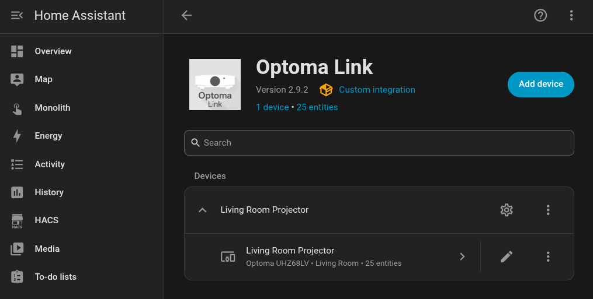
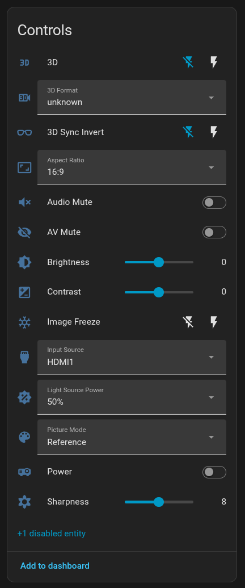
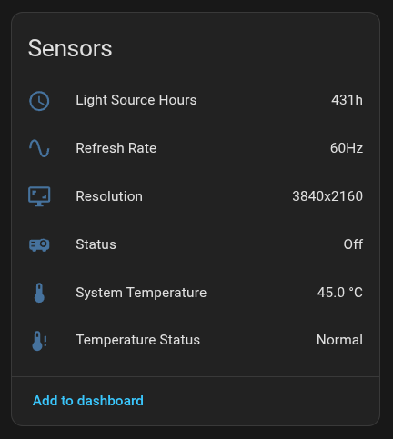
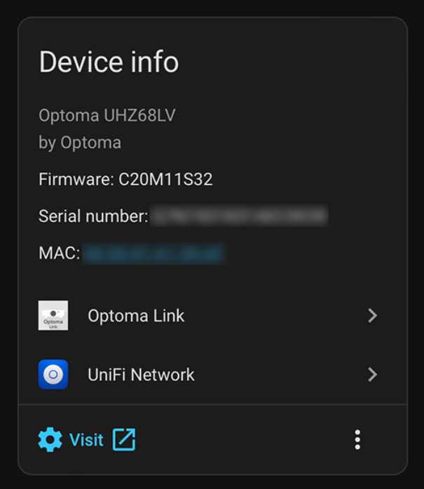

# Optoma Link

Control **Optoma projectors** from [Home Assistant](https://www.home-assistant.io/) over Optoma's RS232 protocol, either on the network (the projector's RJ-45 port, **"RS232 by Telnet"**) or through a **serial cable**.

## Features

- **Network or serial**, with the same commands either way.
- **Automatic model detection** during setup, with an optional test pattern to confirm you're talking to the right projector.
- **Power, inputs, picture settings, 3D, mutes and sensors** as regular Home Assistant entities, ready for scenes and automations.
- **Live status** on supported models: warm-up, cool-down and faults are pushed by the projector and show up instantly.
- **Gentle on the projector:** only enabled entities are polled, and only the power state is polled while the projector is off.

| Controls | Sensors | Device info |
|:---:|:---:|:---:|
|  |  |  |

## Supported projectors

| Model | Profile | Status |
|---|---|---|
| Optoma UHZ68LV | `uhz68lv` | ✅ Verified on hardware |
| Optoma UHD60 | `uhd60` | ✅ Verified on hardware |
| Optoma UHZ65LV | `uhz65lv` | ⚠️ From Optoma documentation |
| Optoma W501 / EW501 / EH501 / X501 | `w501` | ⚠️ From Optoma documentation |
| Optoma ZU650 / ZU650T / ZU650T+ | `zu650` | ⚠️ From Optoma documentation |

Optoma uses the same protocol across its range, so other models usually work once a profile is added. Profiles are plain JSON, no Python needed: see the [profile reference](https://github.com/nerdaxic/optoma_link/blob/main/docs/PROFILES.md). Hardware reports for the unverified models are very welcome.

## Installation

### HACS (recommended)

1. Click the badge above, or in HACS open **⋮ → Custom repositories** and add `https://github.com/nerdaxic/optoma_link` as an **Integration**.
2. **Download** Optoma Link in HACS.
3. **Restart** Home Assistant.

### Manual

Copy `custom_components/optoma_link` from this repository into your Home Assistant `config/custom_components/` folder, then restart Home Assistant.

## Setup

### 1. Prepare the projector

For a **network** connection, with the projector powered on:

1. Connect it to your network and complete its network setup so it has an IP address.
2. Enable **Network → Control → Telnet** and note the port (default `23`).
3. Set **Power Mode (Standby)** to **Communication**, not Eco. Otherwise the projector stops answering the network once it's off, and Home Assistant can't turn it back on.

> **EU/EMEA units:** with the projector's region set to EMEA, the network shuts down in standby even with *Communication* selected. See [Known issues](#known-issues).

For a **serial** connection, enable RS232 control in the projector's menu and connect the cable to the Home Assistant host.

### 2. Add the integration

Or go to **Settings → Devices & services → Add integration** and search for **Optoma Link**. Setup asks for:

| Step | Details |
|---|---|
| Connection | Network or serial. |
| Network details | Host, port (default `23`), projector ID (default `00`), optional RS232 password. |
| Serial details | Port, baud rate (default `9600`), projector ID, optional RS232 password. |
| Model | Auto-detected; confirm or choose from the list, and name the device. |
| Test pattern | Optional, on models that support it. |

The poll interval can be changed later in the integration's options (default 30 s, range 5–300 s).

## How it works

Home Assistant polls the projector at the configured interval, so changes made with the remote can take up to one interval to appear. Power transitions and faults are pushed by the projector and appear right away.

- **Only enabled entities are polled.** Disabling entities you don't use shortens each poll.
- **Only the power state is polled while the projector is off.** Some Optoma firmware stops responding to network commands if it's queried for anything else in standby. The full poll resumes as soon as the projector is on.
- **Write-only controls** (such as 3D, 3D Format, Sharpness and Light Source Power) can't be read back from the projector. They show the last value set from Home Assistant, read **unknown** until you set them once, and don't reflect changes made with the remote.

## Services

| Service | Fields | Description |
|---|---|---|
| `optoma_link.send_command` | `code`, `value` (optional), `entry_id` (optional) | Send a raw RS232 command and return the reply. For anything not exposed as an entity; see Optoma's RS232 command table. |
| `optoma_link.set_test_pattern` | `enabled`, `entry_id` (optional) | Show or hide the built-in test pattern. |

`entry_id` is only needed if you have more than one projector.

## Known issues

- **EU/EMEA region: no network power-on.** Projectors set to the EMEA region switch off their network shortly after power-off to meet EU standby-power limits, even with Power Mode (Standby) set to *Communication*. Home Assistant can then turn the projector off but not back on, and its entities are unavailable while it's off. On a UHZ68LV, changing the region to non-EMEA in the projector's service menu fixed this. Only change the *Region* setting there, and note that doing so is at your own discretion.
- **Change Power Mode (Standby) while the projector is on.** Writing it in standby hasn't been tested, and other commands sent in standby have made the UHZ68LV's network control unresponsive ([#8](https://github.com/nerdaxic/optoma_link/issues/8)).
- **UHZ68LV: the IP Address query can crash the projector's software.** A firmware bug makes `~XX87 3` intermittently crash the projector's `ProjectorService`, and network control can be unavailable for up to about 25 seconds afterwards ([#1](https://github.com/nerdaxic/optoma_link/issues/1)). The IP Address sensor is disabled by default, so a default installation never sends this query.
- **Setup can fail while 3D content is playing.** Turn 3D off before running setup.
- **Some picture modes depend on the content.** The projector refuses modes that don't match what's playing (SDR, HDR, Dolby Vision or 3D), and Home Assistant shows an explanation.

## Contributing

Bug reports, new or corrected projector profiles, and hardware verification of the unverified models are all welcome. Please [open an issue](https://github.com/nerdaxic/optoma_link/issues) or a pull request. For profiles, start with the [profile reference](https://github.com/nerdaxic/optoma_link/blob/main/docs/PROFILES.md). By contributing, you agree that your contribution is licensed under the AGPL-3.0.

Releases follow [Semantic Versioning](https://semver.org/), and the version in `manifest.json` matches the latest [GitHub release](https://github.com/nerdaxic/optoma_link/releases).

## License

Copyright © 2026 nerdaxic. Licensed under the [GNU Affero General Public License v3.0](https://github.com/nerdaxic/optoma_link/blob/main/LICENSE). If the AGPL doesn't work for your use, for example in a closed-source product, a commercial license is available: [open an issue](https://github.com/nerdaxic/optoma_link/issues) to get in touch.

This is an unofficial, community project, not affiliated with or endorsed by Optoma. "Optoma" and model names are trademarks of their respective owners.
